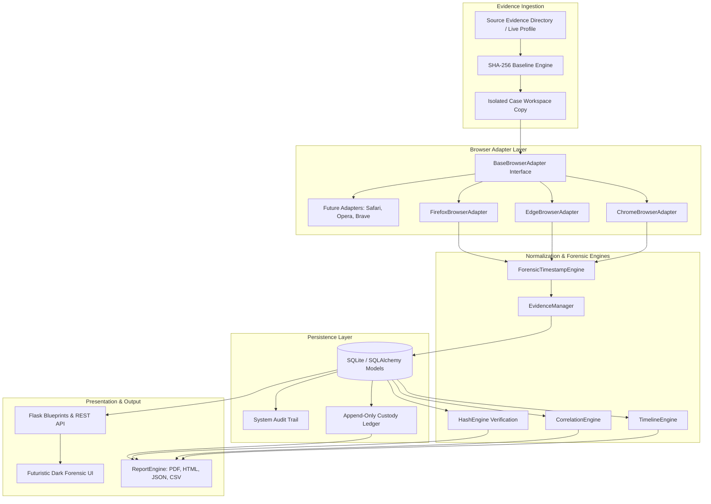

# TraceFusion System Architecture

## Architectural Principles

TraceFusion is built around forensic integrity, strict read-only evidence preservation, modular extensibility, and auditability. The architecture follows a layered pipeline where raw evidence transitions into normalized analytical models and formal evidentiary reports.



---

## 1. Evidence Ingestion & Preservation Layer

### Read-Only Guarantee
When an evidence source (e.g. `C:\Users\Target\AppData\Local\Google\Chrome\User Data\Default`) is selected:
1. `HashEngine` streams through every relevant database (`History`, `Cookies`, `Bookmarks`, `places.sqlite`, etc.) in read-only binary mode (`rb`), computing SHA-256 baselines.
2. An isolated directory structure is created inside `cases/<case_number>/evidence/source_<id>/`.
3. Files are copied into the workspace copy with metadata preservation (`shutil.copy2`).
4. The copied files are immediately hashed and verified to guarantee bit-exact duplication.
5. All subsequent forensic analysis and database queries run exclusively on the forensic copy.

### SQLite Locking & WAL Bypass
Live browser databases often hold active file locks or maintain uncommitted changes in Write-Ahead Log (`-wal`) and Shared Memory (`-shm`) journal files. TraceFusion addresses this by:
- Copying both the main SQLite database and any companion `-wal` / `-shm` files to an isolated temporary analysis sandbox.
- Opening connections using the SQLite URI read-only flag: `file:<path>?mode=ro`.
- Cleaning up temporary files immediately upon query completion.

---

## 2. Modular Browser Adapter Architecture

TraceFusion enforces a strict interface boundary via `BaseBrowserAdapter` located in `app/browser_adapters/base.py`:

```python
class BaseBrowserAdapter(ABC):
    @abstractmethod
    def parse_history(self) -> List[Dict[str, Any]]: ...
    @abstractmethod
    def parse_downloads(self) -> List[Dict[str, Any]]: ...
    @abstractmethod
    def parse_cookies(self) -> List[Dict[str, Any]]: ...
    @abstractmethod
    def parse_bookmarks(self) -> List[Dict[str, Any]]: ...
    @abstractmethod
    def parse_sessions(self) -> List[Dict[str, Any]]: ...
    @abstractmethod
    def parse_cache(self) -> List[Dict[str, Any]]: ...
```

### Supported Adapters
1. **`ChromeBrowserAdapter`** (`app/browser_adapters/chrome.py`):
   - Queries Chromium `History` SQLite database (`urls`, `visits`, `downloads`, `downloads_url_chains`).
   - Extracts `Network/Cookies` or `Cookies` metadata (marking encrypted payloads as `Encrypted/Protected` in compliance with OS security).
   - Recursively parses `Bookmarks` JSON tree.
   - Inspects `Sessions` binary tab records and `Preferences`.

2. **`EdgeBrowserAdapter`** (`app/browser_adapters/edge.py`):
   - Subclasses Chromium architecture while adapting Microsoft Edge profile structures and Edge-specific metadata.

3. **`FirefoxBrowserAdapter`** (`app/browser_adapters/firefox.py`):
   - Queries Mozilla `places.sqlite` (`moz_places`, `moz_historyvisits`, `moz_bookmarks`).
   - Extracts `cookies.sqlite` metadata (`moz_cookies`).
   - Parses `sessionstore.jsonlz4` containers and `cache2` metadata.

---

## 3. Forensic Core Engines

### `ForensicTimestampEngine` (`app/forensic/timestamp_engine.py`)
Provides deterministic conversion across browser epochs:
- **Chromium / WebKit Epoch**: Microseconds since `1601-01-01 00:00:00 UTC` ($11,644,473,600$ seconds offset).
- **Firefox PRTime**: Microseconds since `1970-01-01 00:00:00 UTC`.
- **Unix Epoch**: Seconds and milliseconds.
- Preserves the original raw timestamp alongside normalized UTC strings.

### `CorrelationEngine` (`app/forensic/correlation_engine.py`)
Correlates evidence across independent browser profiles without speculative causal leaps:
- **Multi-Browser Domain Convergence**: Identifies domains visited across multiple distinct browsers.
- **Cross-Platform URL Access**: Flags identical URLs accessed on different browser engines.
- **Temporal Visit-to-Download Correlation**: Maps domain visits immediately preceding file downloads within a 10-minute window.
- **High-Frequency Activity Bursts**: Detects rapid bursts ($\ge 10$ actions within 60 seconds).

### `ReportEngine` (`app/forensic/report_engine.py`)
Generates comprehensive legal documentation:
- **PDF Generation**: Deterministic rendering via ReportLab with formal cover page, two-pass `NumberedCanvas` headers/footers, and legal tables.
- **HTML, JSON, and CSV** export engines.
- Cryptographically hashes each generated report with SHA-256 upon compilation.

---

## 4. Database Schema & Data Models

- **`User`**: Role-based access control (`ADMIN`, `INVESTIGATOR`, `VIEWER`).
- **`Case`**: Master case record with investigator, agency, and status.
- **`EvidenceSource` & `EvidenceFile`**: Original source metadata, file sizes, and baseline SHA-256 hashes.
- **`Artifact`**: Unified record for History, Downloads, Cookies, Bookmarks, Sessions, Cache.
- **`TimelineEvent`**: Chronologically indexed temporal event referencing source artifacts.
- **`CustodyEvent`**: Append-only custody ledger.
- **`AuditLog`**: System and user operational audit log.
- **`ReportRecord`**: Report compilation registry with document SHA-256 hashes.
